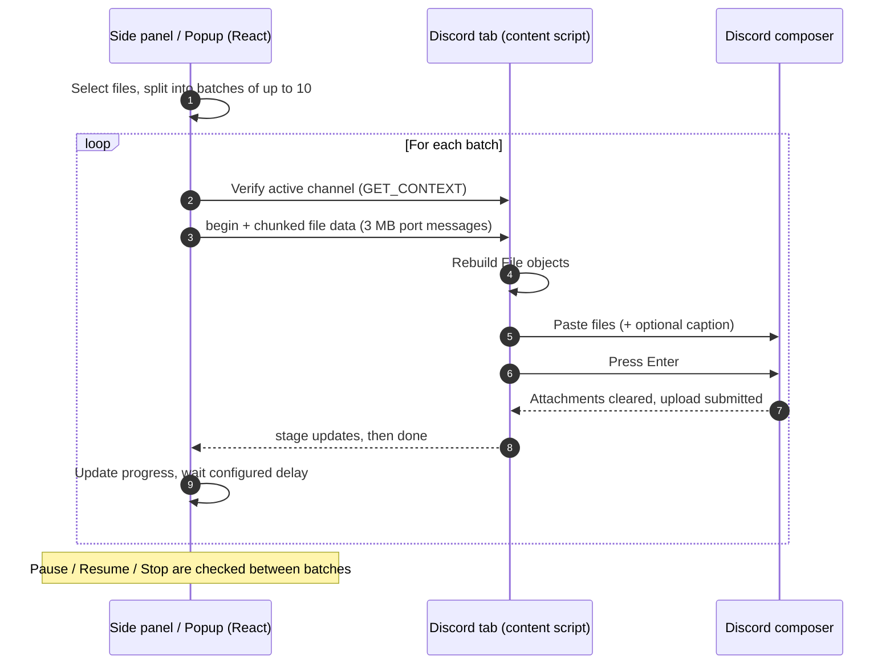

# Dissend

> Send many files to Discord in one go — automatically batched, 10 per message.

A Chrome extension (Manifest V3) that sends large sets of files to the **active Discord channel**, automatically splitting them into messages of up to **10 attachments each** — Discord's per-message limit.

Pick 200 files once; the extension posts them as 20 consecutive messages while you do something else.

## Features

- **Active context detection** — reads the current server and channel (or DM) from the Discord web app and shows it before anything is sent.
- **Automatic batching** — splits files into groups of 1–10 and posts each group as one message.
- **Side panel UI** — drag & drop, per-message grouping preview, progress bar, live log, Pause / Resume / Stop.
- **Toolbar popup** — quick status, run progress and the most common settings.
- **Options page** — files per message, delay between messages, size limit profile, caption.
- **Size-limit profiles** — Free (10 MB), Nitro Basic (50 MB), Nitro (500 MB); oversize files can be skipped automatically.
- **Optional caption** — attach text to the first or every message.
- **Safety checks** — aborts if you switch channels mid-run, if the message box is missing, or if an upload times out.
- **Large-file safe** — files are streamed to the page in 3 MB chunks to stay under Chrome's messaging limits.

## How Dissend uploads



The extension drives Discord's own composer (paste + Enter). It does **not** call private Discord APIs and does **not** read or store your token.

## Tech stack

[WXT](https://wxt.dev) · React 19 · TypeScript · Tailwind CSS v4 · lucide-react · pnpm

## Getting started

### Requirements

- Node.js 20+
- pnpm 9+
- Chrome / Chromium 116+ (side panel API)

### Build

```bash
pnpm install
pnpm build        # outputs to ./dist
pnpm zip          # optional: packaged zip
```

### Load in Chrome

1. Open `chrome://extensions` and enable **Developer mode**.
2. Click **Load unpacked** and select the `dist/` directory.
3. Reload any open Discord tab (content scripts only attach on page load).
4. Open a channel on `discord.com`, click the extension icon, then **Open uploader side panel**.

### Icons

The extension icons are generated by a dependency-free Python script in `tools/icons/` (standard library only):

```bash
pnpm icons              # regenerate public/icon/*.png
```

### Development

```bash
pnpm dev          # launches Chrome with hot reload
pnpm compile      # type-check
```

## Usage

1. Open the target server channel or DM in Discord.
2. Open the side panel and confirm the **Active target** card shows the right server and channel.
3. Drop or choose your files. They are previewed grouped by message.
4. Adjust settings if needed, then click **Send**.
5. Keep the side panel open until the run finishes. Use **Pause** or **Stop** at any time.

## Project structure

```
entrypoints/
  background.ts      context menu, side panel opening
  content.ts         Discord context detection and upload driver
  popup/             toolbar popup
  sidepanel/         main uploader UI
  options/           options page
components/          React UI components
lib/                 types, storage, upload orchestration, hooks
public/icon/         extension icons (generated)
tools/icons/         Python generator for the extension icons
wxt.config.ts        WXT and manifest configuration
```

## Limitations

- Relies on Discord's web DOM (composer and attachment area). A Discord UI update may require selector changes in `entrypoints/content.ts`.
- Discord's limits still apply: file size per account tier, total message size, and rate limiting. Keep a reasonable delay between messages.
- The side panel must remain open while a run is in progress.
- Only `discord.com` is supported (no desktop app).

## Permissions

| Permission | Why |
| --- | --- |
| `sidePanel` | Main uploader interface |
| `storage` | Persist settings and run state |
| `tabs`, `activeTab` | Find the active Discord tab and talk to it |
| `contextMenus` | "Open side panel" shortcut |
| `https://discord.com/*` | Content script on Discord |

## Disclaimer

This project is unofficial and not affiliated with Discord Inc. Automating a user account may conflict with Discord's Terms of Service; use it responsibly and at your own risk.

## License

MIT

---

<p align="right">
  <sub>Forged in the studio by</sub><br>
  <b>✦ K G B &nbsp; R E C O R D ✦</b><br>
  <sub><i>code is our music</i></sub><br>
  <a href="https://github.com/KGBRecord">github.com/KGBRecord</a>
</p>
