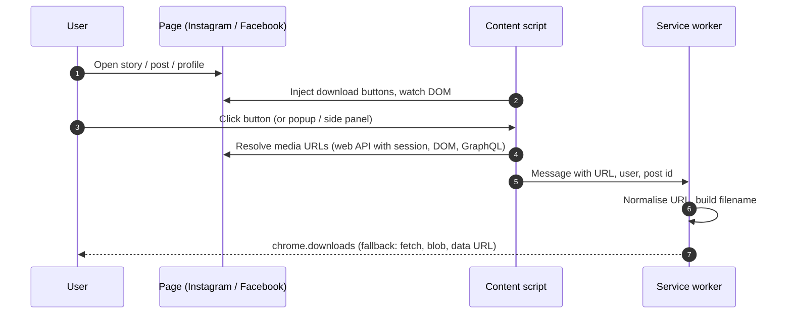
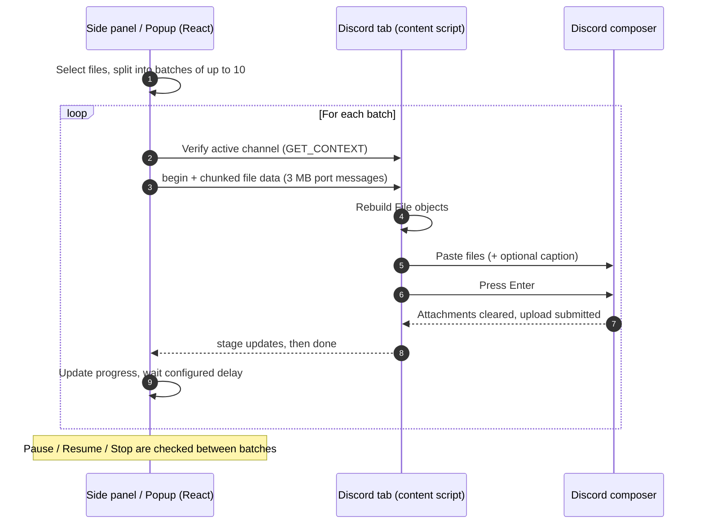

# Decima

> One extension, two tools: batch-upload files to Discord (10 per message) and save stories from Instagram, Facebook and WhatsApp Web.

A Chrome extension (Manifest V3) that sends large sets of files to the **active Discord channel**, automatically splitting them into messages of up to **10 attachments each** — Discord's per-message limit.

Pick 200 files once; the extension posts them as 20 consecutive messages while you do something else.

## Features

- **Active context detection** — reads the current server and channel (or DM) from the Discord web app and shows it before anything is sent.
- **Automatic batching** — splits files into groups of 1–10 and posts each group as one message.
- **Side panel UI** — drag & drop, per-message grouping preview, progress bar, live log, Pause / Resume / Stop.
- **Toolbar popup** — quick status, run progress and the most common settings.
- **Options page** — files per message, delay between messages, size limit profile, caption.
- **Size-limit profiles** — Free (10 MB), Nitro Basic (50 MB), Nitro (500 MB); oversize files can be skipped automatically.
- **Optional caption** — attach text to the first or every message.
- **Safety checks** — aborts if you switch channels mid-run, if the message box is missing, or if an upload times out.
- **Large-file safe** — files are streamed to the page in 3 MB chunks to stay under Chrome's messaging limits.

## Ephemera (built in)

Decima also includes a story/media downloader for **Instagram**, **Facebook** and **WhatsApp Web** — a native part of the extension, not a separate add-on.

- Download buttons are injected on Instagram and Facebook pages (stories, posts, reels, videos, albums, profile bulk download as ZIP).
- From the toolbar popup or the side panel's **Ephemera** tab, download the story/status on the current tab.
- Files are saved with Chrome's downloads API. Everything runs locally, with no telemetry.

### How Ephemera works

1. **Detect** — content scripts on Instagram and Facebook observe the page and inject download buttons on stories, posts, reels, videos and albums. WhatsApp Web statuses are handled on demand.
2. **Find the media** — on Instagram, the script calls the web API with the user's own session (CSRF / `fb_dtsg` token) to resolve original story and post files; story videos are read from the player's React fiber in the page's main world. On Facebook, video URLs are harvested from the DOM, `performance` entries and GraphQL responses.
3. **Trigger** — page buttons, the toolbar popup or the side panel's Ephemera tab send a message to the service worker, which injects the matching on-demand script into the active tab with `chrome.scripting`.
4. **Download** — the service worker saves files through `chrome.downloads`, names them by username and post, and falls back to fetch → blob → data URL when a direct link is refused. Profile bulk downloads are packed into a ZIP with JSZip.



Everything runs locally; no data is sent anywhere except to Instagram or Facebook themselves.

Code lives in `lib/ephemera/` (service worker pipeline), `entrypoints/instagram.content.ts` and `entrypoints/facebook.content.ts` (page scripts), and `entrypoints/ephemera-*.ts` (on-demand scripts).

## How Decima uploads



The extension drives Discord's own composer (paste + Enter). It does **not** call private Discord APIs and does **not** read or store your token.

## Landing page

The project site lives in `site/` (plain HTML, CSS and a little JS, no build step). Open `site/index.html` in a browser, or serve the folder with any static server.

```bash
pnpm build                                               # the screenshots are captured from the built extension
CHROME_BIN="/path/to/chromium" node tools/site/capture-screens.mjs
python3 tools/site/optimize-shots.py                     # PNG to WebP (needs Pillow)
CHROME_BIN="/path/to/chromium" node tools/site/check-layout.mjs   # overflow and broken-image check at 4 widths
```

The screenshots are the real extension UI. The Instagram and Facebook illustrations in `tools/site/mock-pages.html` use the extension's own stylesheet and placeholder photos.

## Tech stack

[WXT](https://wxt.dev) · React 19 · TypeScript · Tailwind CSS v4 · lucide-react · pnpm

## Getting started

### Requirements

- Node.js 20+
- pnpm 9+
- Chrome / Chromium 116+ (side panel API)

### Build

```bash
pnpm install
pnpm build        # outputs to ./dist
pnpm zip          # optional: packaged zip
```

### Load in Chrome

1. Open `chrome://extensions` and enable **Developer mode**.
2. Click **Load unpacked** and select the `dist/` directory.
3. Reload any open Discord tab (content scripts only attach on page load).
4. Open a channel on `discord.com`, click the extension icon, then **Open uploader side panel**.

### Icons

All icons are generated by dependency-free Python scripts in `tools/icons/` (standard library only):

```bash
pnpm icons              # regenerate public/icon/*.png and assets/ephemera/*.svg
pnpm icons:extension    # toolbar / store PNGs only
pnpm icons:ephemera     # Ephemera button SVGs only
```

### Development

```bash
pnpm dev          # launches a browser with hot reload
pnpm compile      # type-check
```

To pin the browser and keep logins between runs, create a local `web-ext.config.ts` (git-ignored) with `binaries` and `chromiumProfile` — see the [WXT docs](https://wxt.dev/guide/essentials/config/browser-startup.html).

## Usage

1. Open the target server channel or DM in Discord.
2. Open the side panel and confirm the **Active target** card shows the right server and channel.
3. Drop or choose your files. They are previewed grouped by message.
4. Adjust settings if needed, then click **Send**.
5. Keep the side panel open until the run finishes. Use **Pause** or **Stop** at any time.

## Project structure

```
entrypoints/
  background.ts      context menu, side panel opening
  content.ts         Discord context detection and upload driver
  instagram.content.ts, facebook.content.ts   Ephemera page scripts
  ephemera-*.ts      Ephemera on-demand scripts
  popup/             toolbar popup
  sidepanel/         main uploader UI
  options/           options page
components/          React UI components
lib/                 types, storage, upload orchestration, hooks
lib/ephemera/        Ephemera (pipeline, Instagram, Facebook modules)
public/icon/         extension icons (generated)
site/                landing page (static)
tools/site/          landing page tooling (screenshots, layout check)
assets/ephemera/     Ephemera button icons (generated)
tools/icons/         Python generators for both icon sets
wxt.config.ts        WXT and manifest configuration
```

## Limitations

- Relies on Discord's web DOM (composer and attachment area). A Discord UI update may require selector changes in `entrypoints/content.ts`.
- Discord's limits still apply: file size per account tier, total message size, and rate limiting. Keep a reasonable delay between messages.
- The side panel must remain open while a run is in progress.
- Discord uploads work on `discord.com` only (no desktop app).
- Ephemera depends on Instagram/Facebook page structure and private web endpoints, which change often.

## Permissions

| Permission | Why |
| --- | --- |
| `sidePanel` | Main uploader interface |
| `storage` | Persist settings and run state |
| `tabs`, `activeTab` | Find the active Discord tab and talk to it |
| `contextMenus` | "Open side panel" shortcut |
| `downloads` | Save story media (Ephemera) |
| `scripting` | Run Ephemera on the current tab |
| `https://discord.com/*` | Content script on Discord |
| Instagram / Facebook / WhatsApp / CDN hosts | Ephemera content scripts and media downloads |

## Disclaimer

This project is unofficial and not affiliated with Discord Inc. Automating a user account may conflict with Discord's Terms of Service; use it responsibly and at your own risk.

## License

MIT

---

<p align="right">
  <sub>Forged in the studio by</sub><br>
  <b>✦ K G B &nbsp; R E C O R D ✦</b><br>
  <sub><i>code is our music</i></sub><br>
  <a href="https://github.com/KGBRecord">github.com/KGBRecord</a>
</p>
